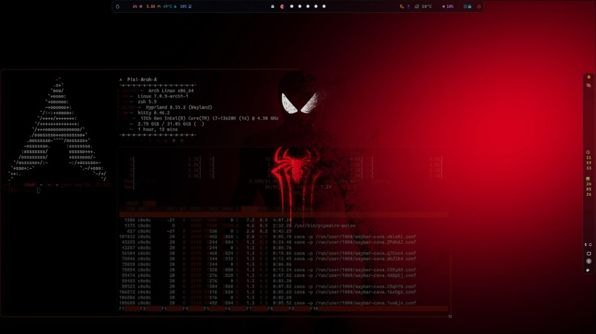

<div align="center">

# Pixi-Arch-A

### Un entorno de escritorio de cristal esmerilado impulsado por Arch Linux y Hyprland


<p align="center">
  
  <br>
  <sub><b>Pixi-Arch-A — Súper Glass & Carmesí Oscuro</b></sub>
</p>

</div>

> [!IMPORTANT]
> **Pixi-Arch-A** es una ramificación personalizada y de alto rendimiento de Arch Linux, diseñada para ofrecer una estética distintiva. Combina la velocidad de **Arch Linux** con el dinamismo del compositor **Hyprland**, sobre un diseño de **Cristal Esmerilado (Frosted Glassmorphism)** cohúltimo (Frosted Glassmorphism)** coherente, con tonos oscuros e iluminación carmesí.

> Incluye un instalador completamente interactivo en español, pensado para ofrecer una experiencia hispanohablante fluida y un acabado visual cuidado al detalle en cada componente.

---

## Índice

- [Características principales](#características-principales)
- [Stack tecnológico](#stack-tecnológico)
- [Compatibilidad y requisitos del sistema](#compatibilidad-y-requisitos-del-sistema)
- [📦 Instalación](#📦-instalación)
- [🔄 Actualización](#🔄-actualización)
- [🗑️ Descargar la configuración antes de la actualización](#-descargar-la-configuración-antes-de-la-actualización)
- [Atajos de teclado y uso](#atajos-de-teclado-y-uso)
- [Bloqueo e inactividad](#bloqueo-e-inactividad)
- [Optimización y modo de juego](#optimización-y-modo-de-juego)
- [Créditos](#créditos)

---

## Características principales

- 🪟 **Glassmorphism coherente** — translucidez y desenfoque aplicados de forma consistente en barra, lanzador, terminales y notificaciones.
- 🎨 **Ciclador de temas Dark Glass** — un clic en el botón de paleta () de la barra superior regenera todo el sistema de color con **Wallust**, de forma automática y cohesiva.
- 🌐 **Instalador 100% en español** — instalación interactiva, guiada y desatendida, sin curva de aprendizaje.
- 🔒 **Bloqueo de sesión inteligente** — aviso e inactividad gestionados centralmente, con `hyprlock` como protector de pantalla.
- 🎮 **Modo de juego integrado** — libera VRAM y CPU desactivando animaciones y efectos con un solo atajo.
- 🧹 **Optimización de sistema incluida** — un script dedicado limpia caché, huérfanos y logs para mantener el equipo ligero.

> [!TIP]
> **Pixi-Arch-A** está diseñado 100% en modo oscuro. Olvídate de fondos claros: cada wallpaper aleatorio genera automáticamente su propia paleta de cristal translúcido.

---

## Stack tecnológico

| Tecnología | Propósito |
|---|---|
| **Arch Linux** | Distribución base |
| **Hyprland 0.57+** | Compositor Wayland (configuración en formato **Lua**) |
| **Waybar** | Barra superior/inferior |
| **Rofi** | Lanzador de aplicaciones / menús |
| **Kitty / Ghostty / WezTerm** | Terminales (soporta múltiples) |
| **Wallust + Matugen** | Generación de paletas de colores desde el wallpaper |
| **Swaync** | Notificaciones |
| **Wlogout** | Menú de cierre de sesión |
| **AGS (Aylur's GTK Shell)** | Widgets GTK personalizados |
| **QuickShell** | Widgets/QML |
| **Btop** | Monitor del sistema |
| **Cava** | Visualizador de audio |
| **Fastfetch** | Estadísticas del sistema |

---

## 📦 Instalación

> El instalador es totalmente interactivo y está en español. Solo tienes que ejecutar el script.

### Requisitos del sistema

- **Arch Linux** (distribución base)
- **Hyprland** (installado automáticamente por el instalador)
- Al menos **2 GB de RAM** (4 GB recomendados)
- **SSD** recomendado para el sistema operativo
- Conexión a internet durante la instalación

---

### Método 1: Instalación desde cero (recomendado)

```bash
# 1. Clonar el repositorio
git clone https://github.com/0o0-ct/Pixi-Arch-A.git ~/Pixi-Arch-A

# 2. Acceder al directorio
cd ~/Pixi-Arch-A

# 3. Dar permisos de ejecución
chmod +x install.sh

# 4. Ejecutar el instalador interactivo
./install.sh
```

El instalador te guiará paso a paso: selección de paquetes, configuración de teclado, temas, fondos de pantalla, etc.

---

### Método 2: Actualizar una instalación existente

Si ya tienes el sistema instalado y quieres actualizar los archivos:

```bash
# 1. Acceder al directorio del proyecto
cd ~/Pixi-Arch-A

# 2. Traer los últimos cambios desde el repositorio
git fetch origin main

git reset --hard origin/main

# 3. Reejecutar el instalador para aplicar las actualizaciones
./install.sh
```

> El instalador detecta automáticamente los paquetes ya instalados y solo aplica las nuevas configuraciones estéticas sin tocar la parte funcional.

---

### 📁 Estructura de la configuración después de la instalación

```
~/.config/hypr/
├── hyprland.lua                    # 🟢 Punto de entrada principal (Lua)
├── lua/                            # 🟢 Módulos Lua (carga modular)
│   ├── monitors.lua
│   ├── env.lua
│   ├── autostart.lua
│   ├── settings.lua
│   ├── decorations.lua
│   ├── animations.lua
│   ├── keybinds.lua
│   ├── rules.lua
│   └── colors.lua
├── scripts/                        # Scripts de utilidad
├── configs/                        # Configuraciones de aplicaciones
│   └── Startup_Apps.conf            # (generado por el instalador)
└── ...                             # Otros archivos generados
```

> La configuración de Hyprland no usa `.conf` (hyprlang) sino **Lua**, para compatibilidad con **Hyprland 0.57+**.

---

## 🔄 Actualización

Para actualizar los archivos del proyecto:

```bash
# 1. Acceder al directorio del proyecto
cd ~/Pixi-Arch-A

# 2. Traer los últimos cambios desde el repositorio
git fetch origin main

git reset --hard origin/main

# 3. Volver a ejecutar el instalador para aplicar las actualizaciones
./install.sh
```

---

## 🗑️ Descargar la configuración antes de la actualización

> Si necesitas conservar tu configuración personal antes de actualizar, se recomienda hacer una copia de seguridad de la carpeta `~/.config/hypr/`.

```bash
# Crear una copia de seguridad de la configuración actual
cp -r ~/.config/hypr ~/.config/hypr-backup-$(date +%Y%m%d)

# O restaurar desde una copia anterior
cp -r ~/.config/hypr-backup-20241104 ~/.config/hypr
```

El proyecto también incluye una carpeta `Hyprland-Dots-Old/` en el repositorio que contiene los archivos originales `.conf` de la migración.

---

## Atajos de teclado y uso

| Atajo | Acción |
|---|---|
| `SUPER + L` | Bloquea la pantalla al instante, con desenfoque e información en tiempo real (`hyprlock` + `hypridle`) |
| `SUPER + D` | Abre el lanzador Rofi, con estética de cristal esmerilado adaptada a la paleta del wallpaper |
| `SUPER + Enter` | Abre una terminal Kitty translúcida |
| `CTRL + SUPER + Espacio` | Alterna el idioma del teclado (Español por defecto / Inglés) |
| `SUPER + SHIFT + G` | Activa o desactiva el Modo de Juego |

| Atajo | Acción |
|---|---|
| `SUPER + Q` | Cerrar ventana activa |
| `SUPER + Space` | Flotar ventana actual |
| `SUPER + SHIFT + F` | Pantalla completa |
| `SUPER + CTRL + F` | Maximizar ventana |
| `SUPER + P` | Alternar pseudo dwindle |
| `ALT + Tab` | Ciclar ventana siguiente |

---

## Bloqueo e inactividad

Toda la gestión de inactividad de la pantalla se centraliza en `hypridle` (configurado vía Lua).

- **Aviso de inactividad** — a los **9 minutos** (`timeout = 540`) recibirás una notificación en el sistema.
- **Bloqueo de seguridad** — a los **10 minutos** (`timeout = 600`) la sesión se bloquea automáticamente mediante `loginctl lock-session`, que activa el protector de pantalla seguro `hyprlock`.

---

## Optimización y modo de juego

**Script de optimización del sistema**

Limpia cachés, elimina paquetes huérfanos, borra logs y optimiza la gestión de RAM:

```bash
bash ~/.config/hypr/scripts/system-optimize.sh
```

**Modo de juego (GameMode)**

- Alterna con **`SUPER + SHIFT + G`** (o desde el menú de configuraciones rápidas). Desactiva animaciones, sombras y fondo animado para liberar VRAM y CPU.
- **GPU Nvidia dedicada en portátiles híbridos:** añade `prime-run %command%` en las opciones de lanzamiento de Steam o Lutris.
- **Feral GameMode:** para títulos exigentes, usa `gamemoderun %command%` y forzar CPU/GPU a máxima frecuencia.

---

<div align="center">

## Créditos

> [!NOTE]
> Este proyecto es un *fork* y una personalización profunda basada en el excelente instalador y dotfiles de **JaKooLit** ([Arch-Hyprland](https://github.com/JaKooLit/Arch-Hyprland)). Gracias por la base sólida, la arquitectura del script y la inspiración original que hicieron posible este entorno de escritorio.

</div>
